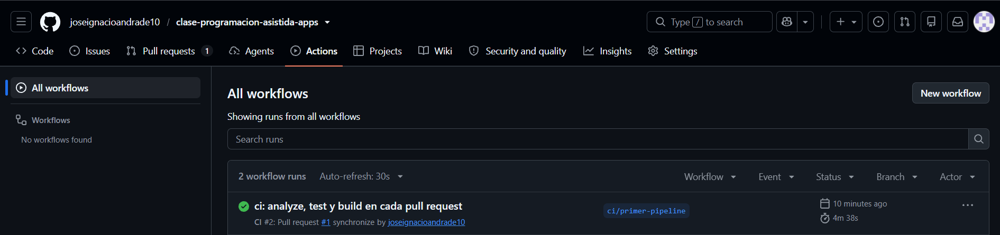
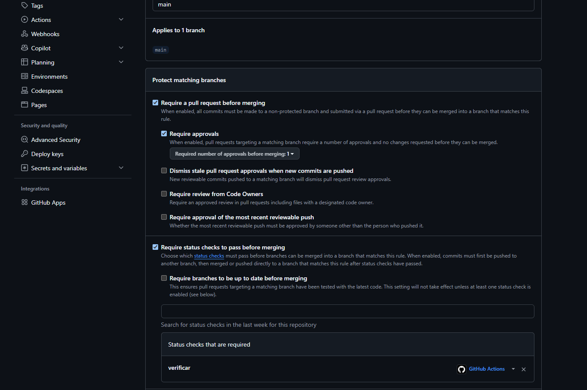
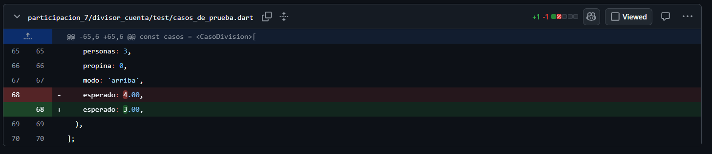
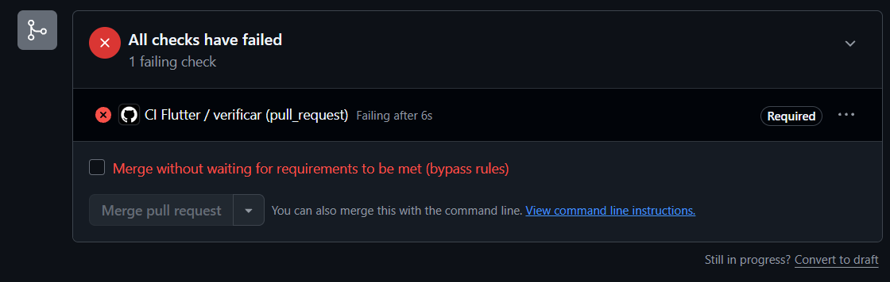
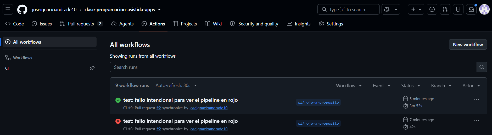
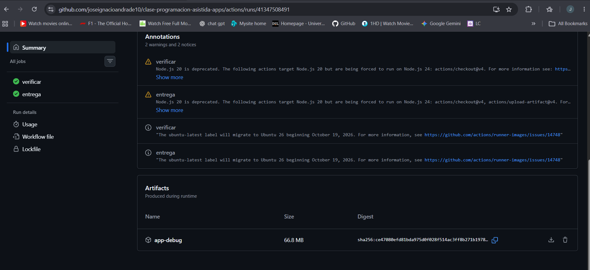

# Respuestas — Deber 4: CI/CD y Entrega Automatizada

**Estudiante:** José Ignacio Andrade  
**Materia:** Programación Asistida de Aplicaciones  
**Proyecto:** Divisor de Cuenta (Flutter)

---

## Parte 1: Integración Continua (CI)

### 1.1 Explicación del Pipeline
El flujo de CI configurado en `.github/workflows/ci.yml` se dispara automáticamente en cada `push` o `pull_request` dirigido a la rama `main`. Ejecuta secuencialmente:
1. **Configuración de Flutter:** Descarga el SDK estable oficial mediante `subosito/flutter-action@v2`.
2. **flutter pub get:** Resuelve e instala las dependencias declaradas en el proyecto.
3. **flutter analyze:** Realiza el análisis estático de código para garantizar que no existan errores de sintaxis, variables sin uso ni violaciones de estilo.
4. **flutter test:** Ejecuta el conjunto completo de pruebas unitarias y de dominio (`test/casos_de_prueba.dart` y `test/division_test.dart`).
5. **flutter build apk --debug:** Verifica que la aplicación compile correctamente para la plataforma Android.

### Evidencia Parte 1

---

## Parte 2: Protección de la Rama Principal (`main`)

### 2.1 Configuración de Reglas
Para garantizar que nunca ingrese código roto o sin verificar a producción, se configuró una regla de protección de rama sobre `main` en GitHub:
* Se exige la creación de un Pull Request antes de fusionar (`Require a pull request before merging`).
* Se exige que los checks de estado pasen obligatoriamente en verde (`Require status checks to pass before merging`), seleccionando el job `verificar` de GitHub Actions.

### Evidencia Parte 2

---

## Parte 3: Verificación del Bloqueo ante Fallos (Fallo Intencional)

### 3.1 Experimento de Fallo Intencional
Se alteró deliberadamente un caso de prueba en `test/casos_de_prueba.dart` (cambiando el resultado esperado de `4.00` a `3.00` en el escenario de redondeo hacia arriba). 
* Al subir la rama `ci/rojo-a-proposito`, el pipeline falló en el paso `flutter test` con una **✗ roja**.
* La regla de protección configurada en la Parte 2 impidió la fusión del Pull Request, deshabilitando el botón **Merge pull request**.

### Evidencias de la Falla

### 3.2 Restauración a Verde
Una vez verificado el bloqueo, se restauró el valor correcto (`4.00`) en el archivo de prueba. El nuevo commit disparó automáticamente el runner de GitHub Actions, devolviendo el estado a **✓ verde** y habilitando el botón para realizar el merge seguro hacia `main`.

### Evidencia de Restauración

---

## Parte 4: Entrega Continua (CD) y Artefactos

### 4.1 Job de Entrega Automatizada
Se implementó el job `entrega` en el workflow con las siguientes condiciones:
* `needs: verificar`: Solo se ejecuta si el job de pruebas y análisis terminó con éxito.
* `if: github.event_name == 'push' && github.ref == 'refs/heads/main'`: Se ejecuta exclusivamente cuando el código ya ha sido fusionado a la rama `main`, evitando compilar artefactos innecesarios en ramas temporales.
* Usa la acción `actions/upload-artifact@v4` para almacenar el archivo binario compilado `app-debug.apk` como un artefacto descargable en GitHub Actions.

### Evidencia Parte 4

---

## Reflexión Final
La implementación de CI/CD complementa de forma natural las metodologías TDD y BDD vistas anteriormente. Mientras que TDD asegura que el código cumpla con los requisitos lógicos en el entorno local, el pipeline de CI/CD actúa como un guardián automatizado e incorruptible que valida que todo el sistema compile, pase el linter y supere las pruebas antes de llegar a la rama principal, eliminando el error humano en el proceso de despliegue.